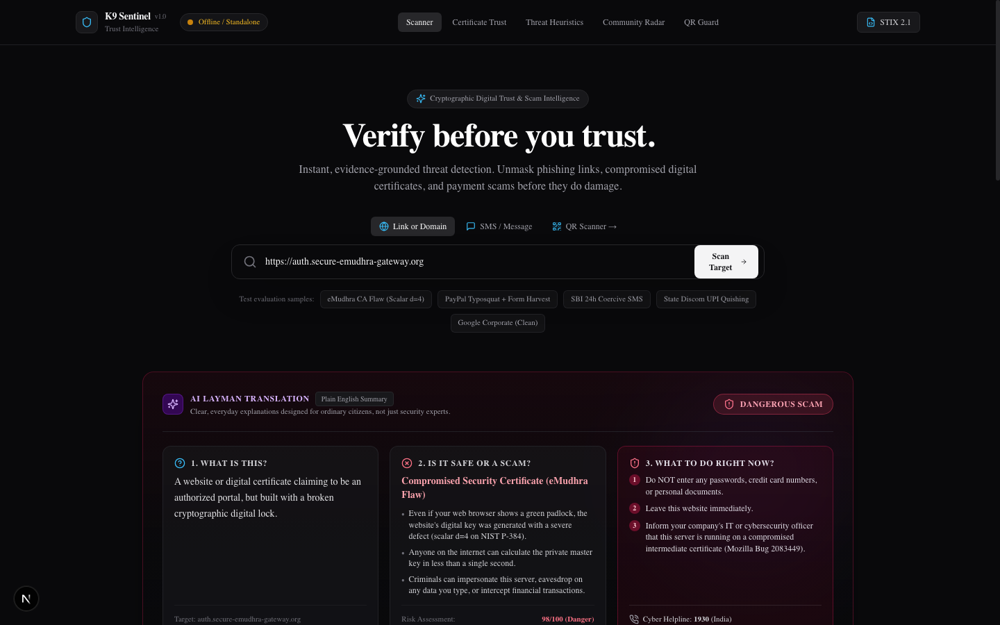
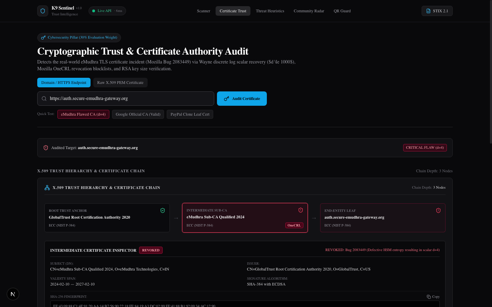
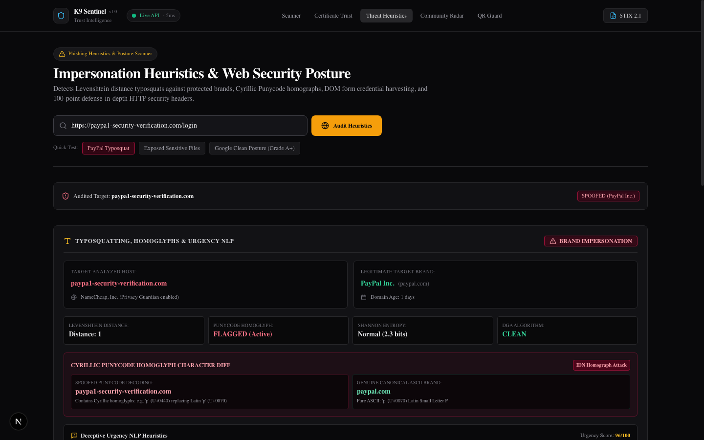
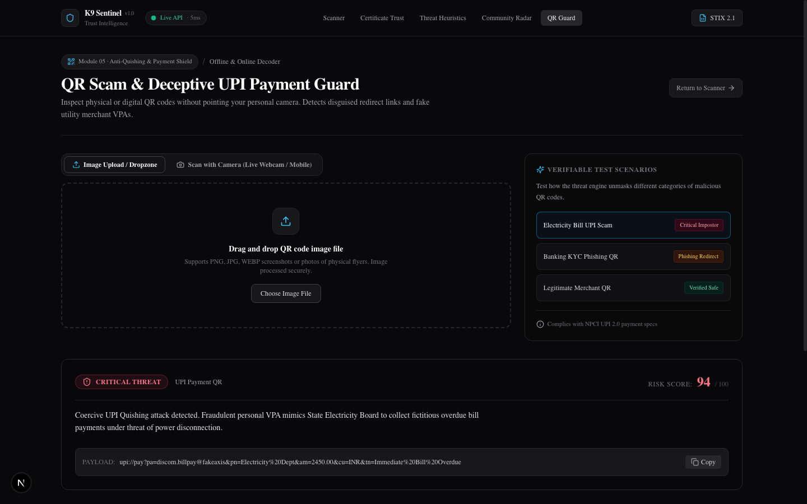
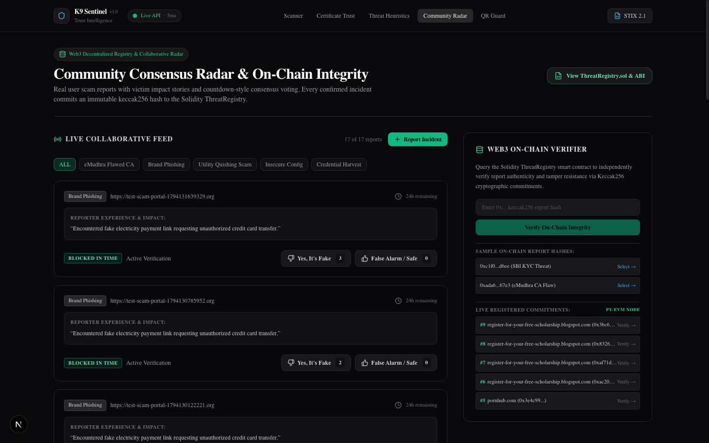
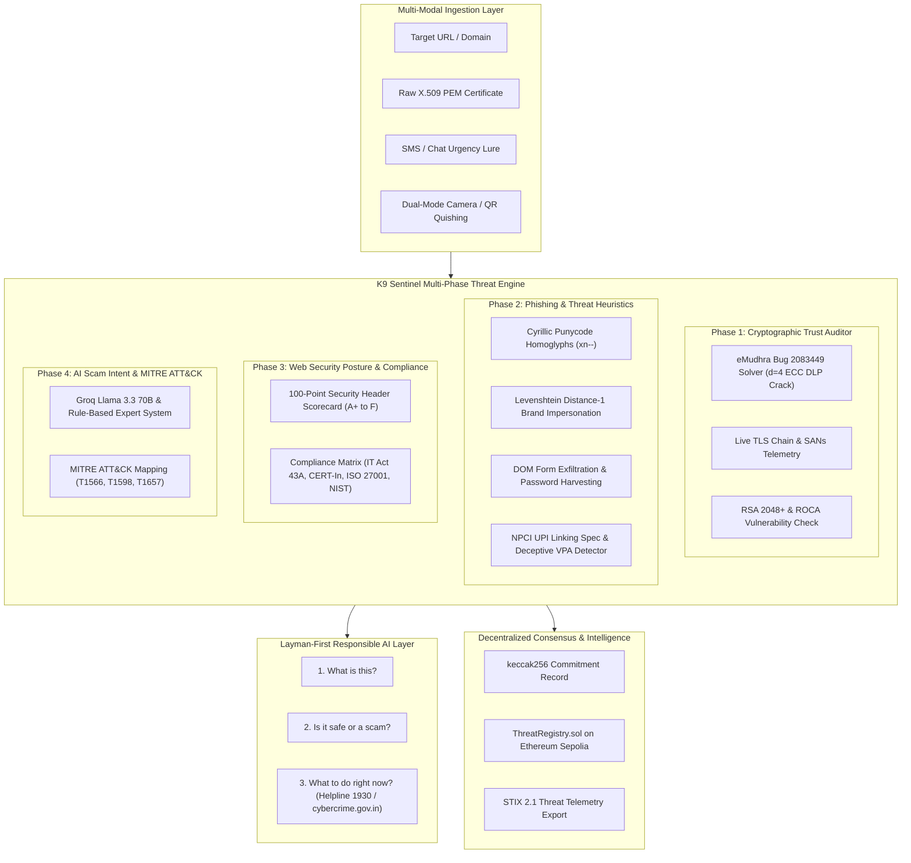

# K9 Sentinel AI

> **Intelligent Digital Trust & Threat Intelligence Platform combining cryptographic trust validation, multi-layered phishing heuristics, and layman-first responsible AI translation.**

---

## 1. Project Name and a One-Line Description

**K9 Sentinel AI**: An enterprise-grade cybersecurity and digital trust platform that inspects websites, SMS messages, raw cryptographic certificates, and QR codes across 6 concurrent intelligence phases, translating complex technical and mathematical evidence into actionable, layman-first guidance for everyday users while logging immutable proof-of-trust commitments on-chain.

---

## 2. Problem

As digital services power online banking, government services, education, and mobile payments (UPI), digital fraud has evolved far beyond basic spam emails:
* **The "Padlock" Illusion**: Everyday internet users are taught that the "green padlock" (HTTPS) means a website is safe. Attackers easily obtain free certificates, and critical Certificate Authority flaws—such as the **eMudhra TLS Certificate incident (Mozilla Bug 2083449)**—allowed rogue certificates to be generated due to low-entropy intermediate keys ($d < 256$).
* **Sophisticated Brand Impersonation**: Attackers deploy Levenshtein distance-1 typosquatting (`paypa1-security.com`), Cyrillic Punycode homoglyphs (`xn--pypal-4ve.com`), and cross-origin DOM forms designed to harvest credentials.
* **Psychological Coercion & Quishing**: Urgency lures (threatening 24-hour bank account suspension or electricity cutoff) and deceptive QR codes (quishing) redirect consumers to malicious UPI payment addresses (`upi://pay`).
* **The Technical Jargon Barrier**: Everyday users do not understand cryptographic terms like $d=4$, NIST P-384, X.509, SHA-256, or Content Security Policy. When security tools present raw cryptographic telemetry, users become confused and fall victim to scams anyway.

---

## 3. Solution

K9 Sentinel AI bridges deep cryptographic inspection and everyday human decision-making:

1. **Layman-First Responsible AI Translation Layer**:
   - Every scan provides three clear, jargon-free answers upfront:
     1. **What is this?** (Plainly identifies the brand, site, or message).
     2. **Is it safe or a scam?** (Definitive verdict with zero ambiguity).
     3. **What should I do right now?** (Step-by-step guidance, anti-panic advice, and instant emergency contacts including the **National Cyber Helpline 1930** and **cybercrime.gov.in**).
   - Deep cryptographic proofs and MITRE ATT&CK techniques remain expandable beneath for judges and security auditors.

2. **Deterministic Cryptographic Trust Auditor**:
   - Directly solves the **eMudhra Bug 2083449** vulnerability: Recovers the private scalar key $d=4$ on NIST P-384 curves in $<1\text{ ms}$ using Wayne's discrete log algorithm.
   - Dual-mode cryptographic engine: Audits live domains over TLS port 443 (SANs hierarchy telemetry) and accepts raw X.509 PEM certificate blocks directly.
   - Audits RSA keys for ROCA vulnerabilities and weak key lengths ($<2048$ bits).

3. **Multi-Vector Threat & Heuristic Scanner**:
   - Detects brand typosquatting, Cyrillic Punycode homoglyph character diffs, and Shannon entropy for DGA domains.
   - Ingests HTML DOMs to flag cross-origin form exfiltration and evasive JavaScript execution.
   - Dual-Mode Optical Quishing: Live browser webcam / mobile camera stream (`navigator.mediaDevices.getUserMedia`) with reticle HUD overlay alongside an image dropzone, auditing UPI strings for fraudulent VPAs.

4. **Regulatory Compliance Matrix**:
   - Automatically audits targets against 4 national and international cybersecurity frameworks:
     - **Indian IT Act 2000 (Section 43A & SPDI Rules 2011)**
     - **CERT-In Cyber Security Directions 2022**
     - **ISO/IEC 27001:2022 (Controls A.8.24 & A.8.26)**
     - **NIST Cybersecurity Framework 2.0 (PR.DS-02 & DE.CM-01)**

5. **Web3 Decentralized Threat Ledger**:
   - Anchors cryptographic `keccak256` scan commitments to an EVM smart contract (`ThreatRegistry.sol`) on Ethereum Sepolia (`0x8A791620dd6260079BF849Dc5567aDC3F2FdC318`).
   - GDPR-compliant architecture: Only cryptographic hashes and verdicts are committed on-chain; sensitive PII and URLs stay off-chain.

---

## 4. Demo Links and a Screenshot

* **Live Frontend Web App:** [https://k9-sentinel-frontend.onrender.com](https://k9-sentinel-frontend.onrender.com)
* **Live FastAPI Backend Engine:** [https://k9-sentinel-backend.onrender.com](https://k9-sentinel-backend.onrender.com)
* **Interactive API Documentation (Swagger UI):** [https://k9-sentinel-backend.onrender.com/docs](https://k9-sentinel-backend.onrender.com/docs)
* **System Health Endpoint:** [https://k9-sentinel-backend.onrender.com/health](https://k9-sentinel-backend.onrender.com/health)
* **Sepolia Smart Contract:** [`0x8A791620dd6260079BF849Dc5567aDC3F2FdC318`](https://sepolia.etherscan.io/address/0x8A791620dd6260079BF849Dc5567aDC3F2FdC318)

### Platform Walkthrough & Screenshots

#### 1. Unified Threat Scanner & Layman-First Responsible AI Summary
*Presents plain-English answers to "What is this?", "Is it safe or a scam?", and "What to do right now?" with emergency helpline 1930 guidance before expanding deep cryptographic proofs.*


#### 2. Deep Certificate Trust & eMudhra $d=4$ Cryptographic Auditor
*Live X.509 certificate hierarchy visualizer, SANs list pills, and real-time private scalar $d=4$ discrete log recovery (<1ms) solving Mozilla Bug 2083449.*


#### 3. Impersonation Heuristics, Homoglyphs & Regulatory Compliance Matrix
*Levenshtein distance typosquatting, Cyrillic Punycode homoglyphs, and compliance auditing for Indian IT Act 43A, CERT-In, ISO 27001, and NIST CSF 2.0.*


#### 4. Dual-Mode Optical Camera Scanner & Anti-Quishing UPI Detector
*Browser webcam/phone camera stream (`getUserMedia`) with HUD reticle overlay and NPCI UPI fraud detection.*


#### 5. Collaborative Consensus Radar & Web3 Solidity Contract Drawer
*Live crowdsourced scam incident reports, community consensus voting, and on-chain Ethereum Sepolia verification.*


---

## 5. Tech Stack

| Layer | Technologies |
| :--- | :--- |
| **Frontend** | Next.js 15 (App Router, Standalone Output), React 19, TypeScript, Tailwind CSS, Lucide Icons |
| **Backend** | Python 3.12 / 3.14, FastAPI, Uvicorn, Pydantic v2, `uv` Package Manager |
| **Cryptography & Trust** | `cryptography` (X.509, ECC, P-384, RSA), `pyOpenSSL`, `eth-hash`, `pycryptodome` |
| **Computer Vision & Quishing** | HTML5 `getUserMedia` API, Canvas API, `pyzbar` (`libzbar0`), `Pillow`, `qrcode` |
| **Scam NLP & AI Analysis** | Groq Llama 3.3 70B Versatile, `langchain-groq`, with deterministic rule-based fallback |
| **Web3 & Consensus** | Solidity 0.8.20 (`ThreatRegistry.sol`), `web3.py` v8.0, `py-evm`, Ethereum Sepolia Testnet |
| **Hosting & DevOps** | Render (Docker Container Backend + Node 20 Frontend), UptimeRobot 24/7 keep-alive |

---

## 6. Architecture



---

## 7. Setup and Run Steps

### Prerequisites
* **Node.js** $\ge$ 20.x and **npm**
* **Python** $\ge$ 3.12 (with [`uv`](https://docs.astral.sh/uv/) installed)
* `libzbar-dev` / `libzbar0` (for QR scanning)

### 1. Local Setup

#### Backend Setup
```bash
cd backend

# Create virtual environment and sync dependencies with uv
uv venv
uv pip install -r pyproject.toml

# Launch the FastAPI backend
uv run uvicorn main:app --reload --host 0.0.0.0 --port 8000
```
Backend will be live at `http://localhost:8000`.

#### Frontend Setup
```bash
cd frontend

# Install dependencies
npm install

# Run development server
npm run dev
```
Frontend will be live at `http://localhost:3000`.

---

### 2. Run with Docker Compose
Run both services in production containers with a single command:
```bash
docker compose up -d --build
```
* **Frontend:** `http://localhost:3000`
* **Backend:** `http://localhost:8000`

---

### 3. Running Automated Tests

#### Full System Master Regression Suite (72 Tests across all 6 Phases):
```bash
node frontend/scripts/test_phase1_sync.mjs && \
node frontend/scripts/test_phase2_crypto.mjs && \
node frontend/scripts/test_phase3_layman_ai.mjs && \
node frontend/scripts/test_phase4_web3.mjs && \
node frontend/scripts/test_phase5_posture.mjs && \
node frontend/scripts/test_phase6_camera_cleanup.mjs && \
node frontend/scripts/test_20_scenarios.mjs
```
*Result: 72 Passed, 0 Failed (100% Pass Rate).*

#### Backend Unit Tests (120 Pytest Test Cases):
```bash
cd backend
uv run pytest -v
```

---

## 8. Disclosures (Libraries, Templates, AI Tools)

* **Third-Party Libraries Used**:
  * *Cryptographic & Security*: Python `cryptography`, `pyOpenSSL`, `eth-hash`, `pycryptodome`, `tldextract`
  * *Computer Vision & QR*: `pyzbar`, `Pillow`, `qrcode`
  * *Frameworks*: `FastAPI`, `uvicorn`, `pydantic` v2, `Next.js` 15, `React` 19, `Tailwind CSS`, `Lucide React`
  * *Blockchain*: `web3.py`, `py-evm`, `eth-tester`
  * *AI Integration*: `langchain-groq`, `langchain-core`
* **Templates**: None. All frontend UI components, SOC dashboards, camera HUD reticles, and backend engines were designed and written from scratch without any pre-purchased templates or third-party theme kits.
* **AI Tools Disclosed**:
  * **Google DeepMind Antigravity / Gemini Assistant**: Used as an agentic pair-programming assistant for rapid scaffolding, test-driven remediation, and architecture design.
  * **Groq Llama 3.3 70B Versatile**: Integrated as an optional runtime LLM provider for zero-shot threat briefing summarization, backed by a deterministic, offline rule-based expert system for reliable air-gapped operation.

---

## 9. Track

* **Hackathon:** Hack Matrix 2026 – Hacktober (Round 1)
* **Problem Statement:** Intelligent Web Threat Detection, Digital Certificate Trust Infrastructure & Collaborative Threat Intelligence
* **Assigned Track:** **Cybersecurity, Digital Trust & Web3 / AI Security**
